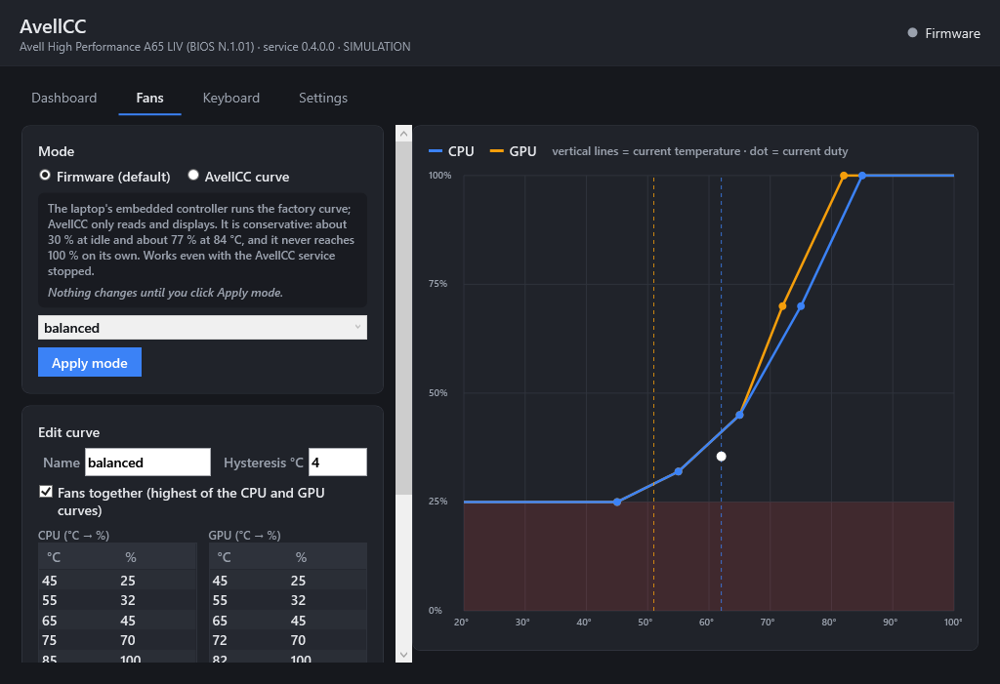
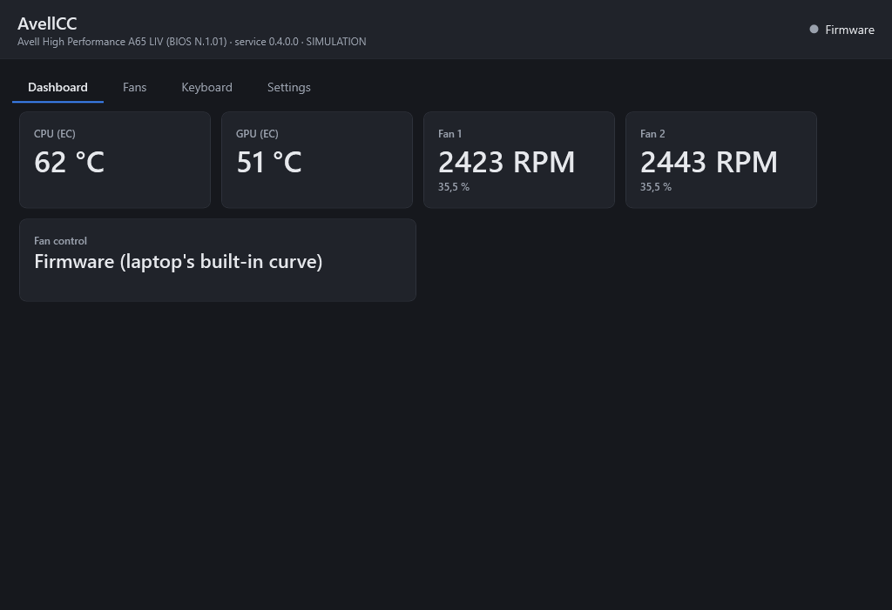
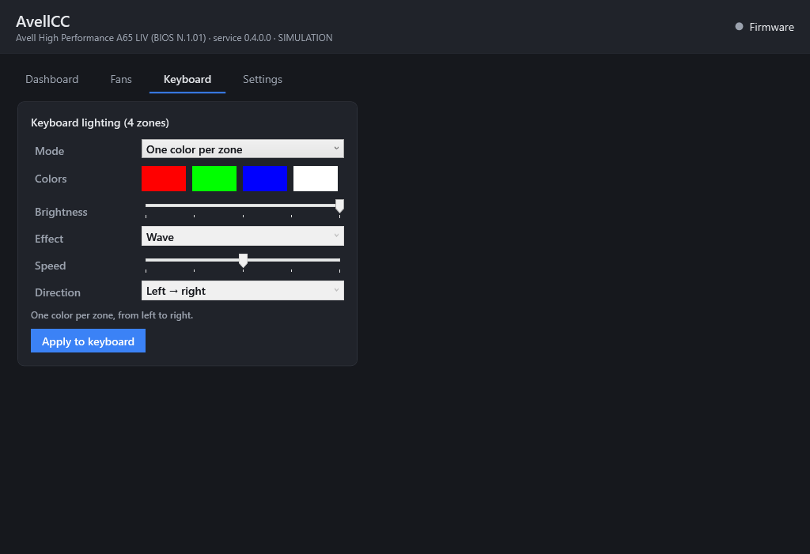

# AvellCC — Avell Custom Control Center

Open replacement for *Avell Custom Control* on Windows: **keyboard RGB** and **custom fan curves** for Avell laptops
built on the **Uniwill** (TongFang-family) platform.



- **Fan curves applied in software** — this EC ignores custom curves in firmware, so a Windows service reads the EC
  temperatures every 2 s and sets the fan duty directly, with hysteresis, smooth slow-down, a 25 % minimum,
  100 % emergency override, and automatic hand-back to the firmware on stop, sleep or error.
- **Keyboard RGB (4 zones)** — single color, one color per zone, or firmware effects with your own palette.
- **Tray app** — live temperatures, RPM and duty, quick fan-mode switch, starts with Windows.
- **English and Portuguese UI** — one JSON file per language, easy to extend
  (see [src/AvellCC.App/Languages/README.md](src/AvellCC.App/Languages/README.md)).
- **Safety first** — immutable backups of the original EC state, read-back verification of every write, and it refuses to
  run alongside the vendor app.

| Dashboard | Keyboard |
|---|---|
|  |  |

## Tested with

| Laptop | BIOS | EC project ID | Keyboard | Status |
|---|---|---|---|---|
| **Avell A65 LIV** (sold as C65 LIV; SMBIOS `Avell High Performance` / `A65 LIV`) | AMI N.1.01 | `0x0F` | ITE 8291 `048D:CE00`, 4 zones | ✅ fans (direct control), ✅ keyboard RGB, Windows 11 |

All hardware findings, register maps and the full test log are in [docs/HARDWARE.md](docs/HARDWARE.md).

## May work on other TongFang / Uniwill laptops (untested)

Many laptops sold under other brands share this platform (Uniwill/TongFang chassis with the same EC firmware family and
ITE keyboard controllers — e.g. some XMG, TUXEDO, Eluktronics, Schenker, PCSpecialist and other Avell models).
AvellCC **may** work on them, but **it has not been tested** and EC layouts differ between generations. Before writing
anything on another model:

1. Run the read-only diagnostic (`tools/diag/Invoke-AvellDiag.ps1`) and compare with docs/HARDWARE.md:
   EC project ID at `0x740`, temperatures at `0x43E/0x44F`, RPM at `0x464/0x46C`, and `0x78E` bit 6
   (set = "universal" fan control with firmware tables, which this project does not use).
2. Try `avellcc fan direct trial 50 30` (always restores at the end) and check that the RPM changes.
3. Keyboard: check that `avellcc kb info` finds a `048D` device with usage page `0xFF12`.

Reports for other models are welcome — please open an issue with the diagnostic output (it does not include serial numbers).

## Install

Requires Windows 10/11 x64 and the [.NET 8 SDK](https://dotnet.microsoft.com/download/dotnet/8.0)
(`winget install Microsoft.DotNet.SDK.8`). From an elevated PowerShell in the repository folder:

```powershell
powershell -ExecutionPolicy Bypass -File .\tools\install.ps1
```

The script runs the tests, publishes to `C:\Program Files\AvellCC`, **stops and disables the vendor's `GCUBridge`
service**, creates the `AvellCC` service (LocalSystem, automatic start, automatic restart on failure), adds a Start Menu
shortcut and opens the app. Fans start in **firmware** mode; pick a curve in the **Fans** tab and click **Apply mode**.

Uninstall (keeps the backups; `-RestoreVendor` re-enables Avell Custom Control):

```powershell
powershell -ExecutionPolicy Bypass -File .\tools\uninstall.ps1 -RestoreVendor
```

### Firmware vs. AvellCC curve

| | Firmware (default) | AvellCC curve |
|---|---|---|
| Who decides the speed | the laptop's EC, factory curve | the AvellCC service, from your curve |
| Behaviour (measured) | ~30 % idle, ~77 % at 84 °C, never 100 % on its own | whatever the curve says, 25 %–100 % |
| Without the service | keeps working | falls back to firmware |

Built-in curves: `balanced`, `silent`, `performance`, and `max` (100 % always — identical to the vendor's *Fan Boost*,
which is the EC's ceiling; see docs/HARDWARE.md).

## How it works

```
AvellCC.exe (WPF + tray, no admin) ──named pipe──► AvellCC service (LocalSystem)
                                                     ├─ fans: software curve → direct duty in the EC (0x1804/0x1809)
                                                     ├─ keyboard: ITE 8291 (HID), 4 zones
                                                     └─ C:\ProgramData\AvellCC (settings.json, curves\, backup\)
```

Details, safety rules and design decisions: [docs/ARCHITECTURE.md](docs/ARCHITECTURE.md).

## Repository layout

```
src/AvellCC.Core     EC (WMI), direct fan control, curve controller, control loop, keyboard, backups, settings
src/AvellCC.Ipc      pipe protocol, server and client
src/AvellCC.Service  Windows service (power events, automatic restart)
src/AvellCC.App      WPF UI + tray, Languages/*.json
src/AvellCC.Cli      avellcc.exe: diagnostics and hardware experiments (refuses to write while the service runs)
tests/               unit and integration tests (fake EC, fake HID transport, real named pipe)
tools/               read-only diagnostic (PowerShell), install.ps1, uninstall.ps1
curves/              example curves and the probes used in the hardware tests
docs/                hardware notes and architecture
```

## Develop without hardware

```powershell
dotnet build AvellCC.sln -c Release
dotnet test AvellCC.sln
.\src\AvellCC.Service\bin\x64\Release\net8.0-windows\AvellCC.Service.exe --simulate
.\src\AvellCC.App\bin\x64\Release\net8.0-windows\AvellCC.exe --simulate
```

`--simulate` uses a simulated EC (load wave, thermal model) and a separate pipe (`AvellCC.Control.sim`).
It needs no admin rights and never touches the hardware. `AvellCC.exe --lang pt-BR` forces a UI language;
`--screenshot <folder>` renders every tab to PNG.

## Disclaimer

This project is not affiliated with or endorsed by Avell, Uniwill or TongFang. It writes to your laptop's embedded
controller; it was built and tested carefully on one machine, but **use it at your own risk**. Register knowledge comes
from interoperability analysis of the vendor software on the author's own machine, from public sources, and from
hardware tests; no vendor code is included.

## Credits

- [tuxedo-drivers](https://github.com/tuxedocomputers/tuxedo-drivers) (GPL) — the direct fan-control mechanism for
  legacy Uniwill ECs and its safety rules (no code copied).
- [Clevo-Monster-RGB-Controller](https://github.com/gutsv-project/Clevo-Monster-RGB-Controller),
  [custom-clevo-laptop-controller-windows-app](https://github.com/farukborann/custom-clevo-laptop-controller-windows-app),
  [BtoFanControl](https://github.com/Marqis/BtoFanControl) — Clevo projects used as architecture references
  (tray, startup, curve rules, hysteresis), not as protocol references.
